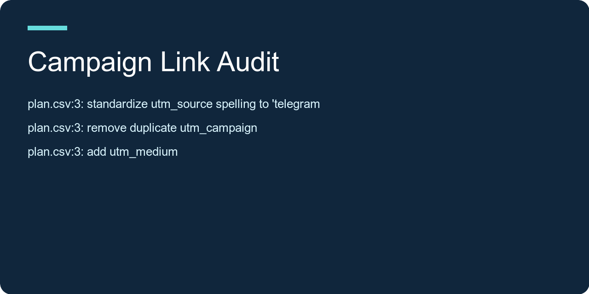

# Campaign Link Audit

[Русский](README.ru.md)

Catch tracking errors across a CSV media plan before the campaign launches.



```sh
git clone https://github.com/TONstories/campaign-link-audit.git
cd campaign-link-audit
python3 audit.py examples/plan.csv
```

```text
plan.csv:3: standardize utm_source spelling to 'telegram'
plan.csv:3: remove duplicate utm_campaign
plan.csv:3: add utm_medium
```

Supply a UTF-8 CSV with a url header. Scan absolute HTTP(S) links for missing source, medium and campaign fields, duplicate UTM keys and case or space variations. The first spelling is the reference within a file. Values are URL-decoded. Your input is read only.

Python 3.9+. Add --json for structured results. Exit codes: 0 passes the implemented checks, 1 has findings, 2 indicates an input or invocation error.

0.049 s · macOS · Python · bundled example · single local run.

Built by TON Stories, a marketplace connecting advertisers with creators for Telegram Stories campaigns. [TON Stories](https://tonstories.com/?utm_source=github&utm_medium=referral&utm_campaign=open_source&utm_content=campaign-link-audit) · [Telegram](https://t.me/TON_Storiesbot?start=gh_campaign_link_audit)
